# BUILD

Make it yours.

**[Open the live studio](https://build-keyboard.vercel.app)**

BUILD is a 3D studio for designing a custom mechanical keyboard in the browser. Pick a layout, a case and every part inside it. The keyboard is generated from that configuration in real time, a rules engine checks that the parts work together, and you can take it apart, type on it, hear it and export a render.

It has no model files, no backend and no account. Every part is computed in millimetres from data.

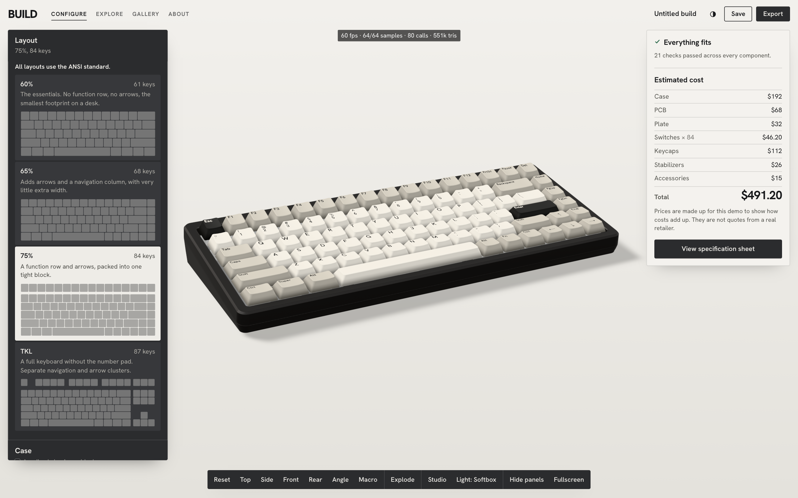

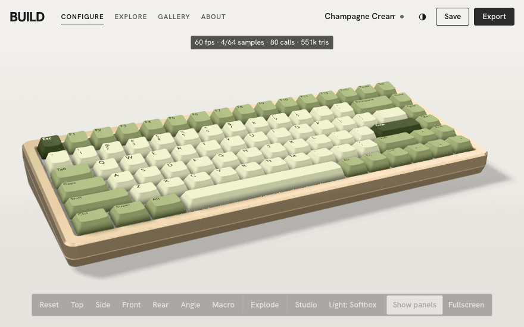

## What you can do

| | |
|---|---|
| **Layouts** | 60%, 65%, 75% and TKL, all ANSI. Changing the layout recuts the case, plate and PCB and moves every switch, stabilizer and keycap. |
| **Case** | Anodized aluminum, painted aluminum, polycarbonate and frosted translucent polymer. Seven colours including custom, four finishes and three mounting styles, each offered where the material allows it. |
| **Keycaps** | Three sculpted profiles, three materials, six themes and your own saved themes. Edit single keys, shift-selected keys or named groups, from the 3D model or a flat key plan. |
| **Switches** | Six simulated switches across linear, tactile and clicky, each with a force curve and a close-up view that shows the stem, spring and contacts moving. |
| **Compatibility** | 21 rules, with plain-language errors and warnings, fixes one click away, and each option showing what it would break before you pick it. |
| **Exploded view** | Nine physical layers separate along the assembly axis with labels and leader lines. Pause it, scrub it, change the spacing, or isolate a part. |
| **Typing test** | Physical keys press the matching keys on the model, with held keys, rollover and synthesized sound that changes with the switch, plate, case and foam. |
| **Studio** | Five backdrops, three lighting rigs, camera presets, real depth of field, a title overlay and PNG export up to 6144 px. |
| **Your builds** | Save, duplicate, delete, import and export JSON, a gallery with real renders, and an A4 build sheet. |

Also: undo and redo, dark mode, phone and tablet layouts, keyboard access to every control, and reduced-motion support.

| | |
|---|---|
| 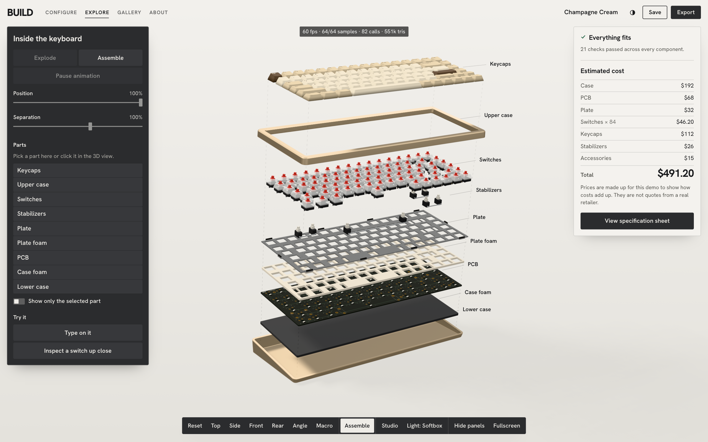 | 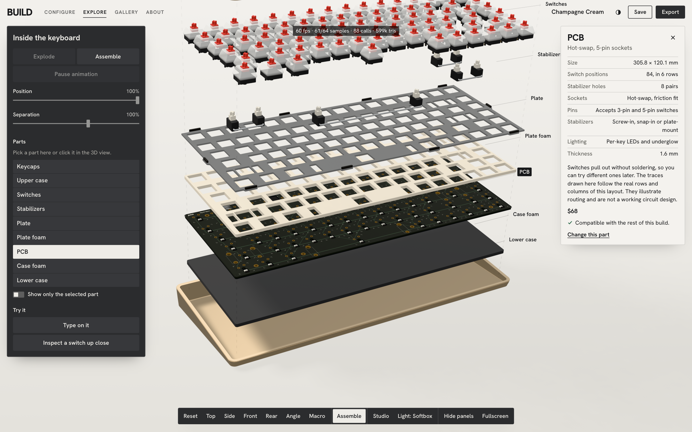 |
| 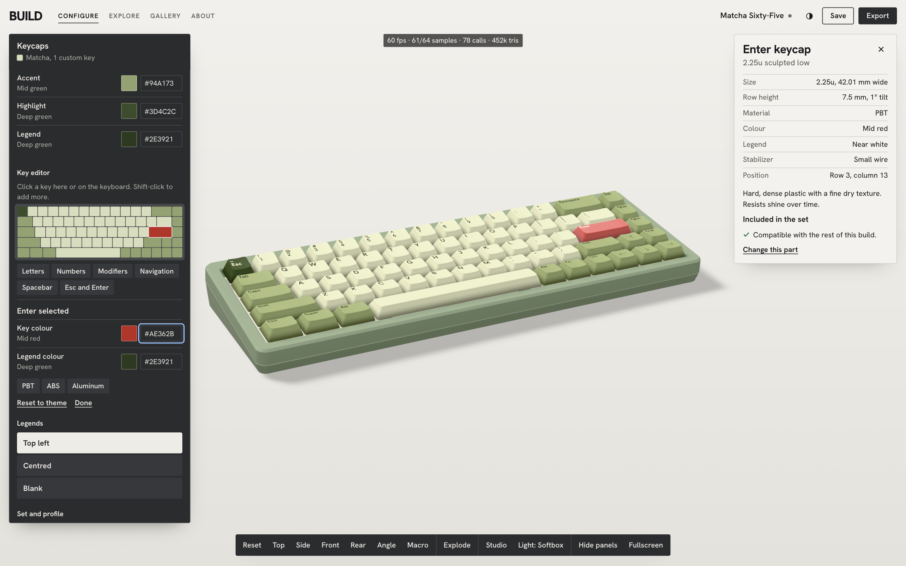 | 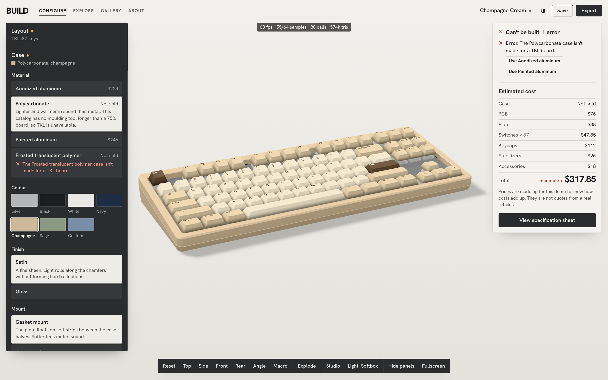 |
| 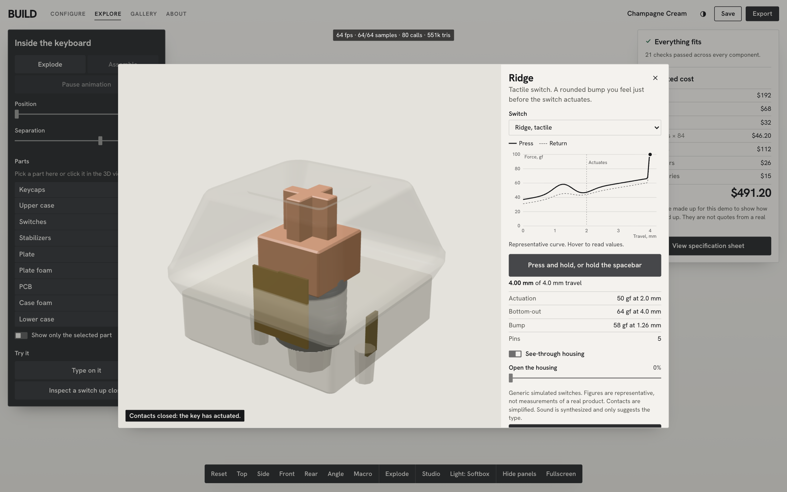 | 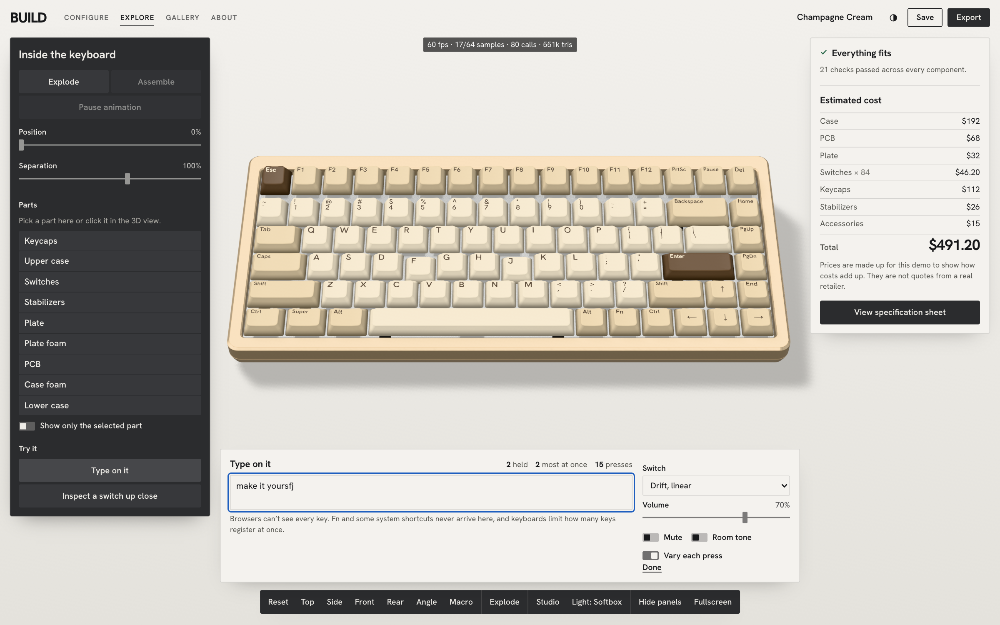 |
| 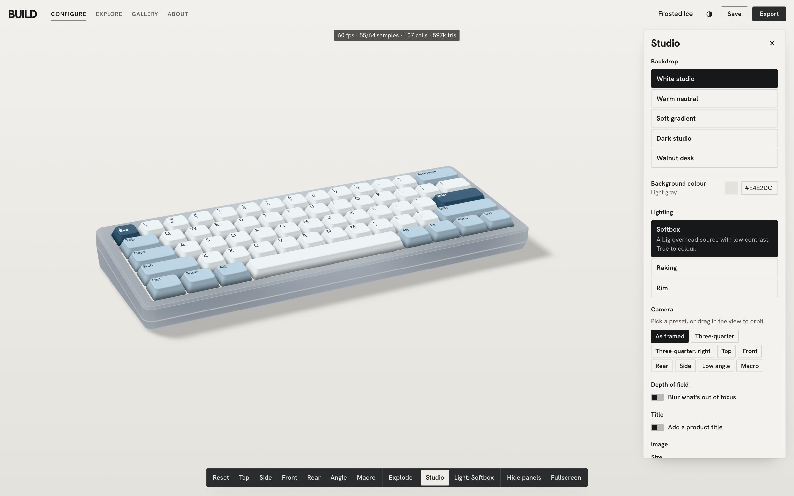 | 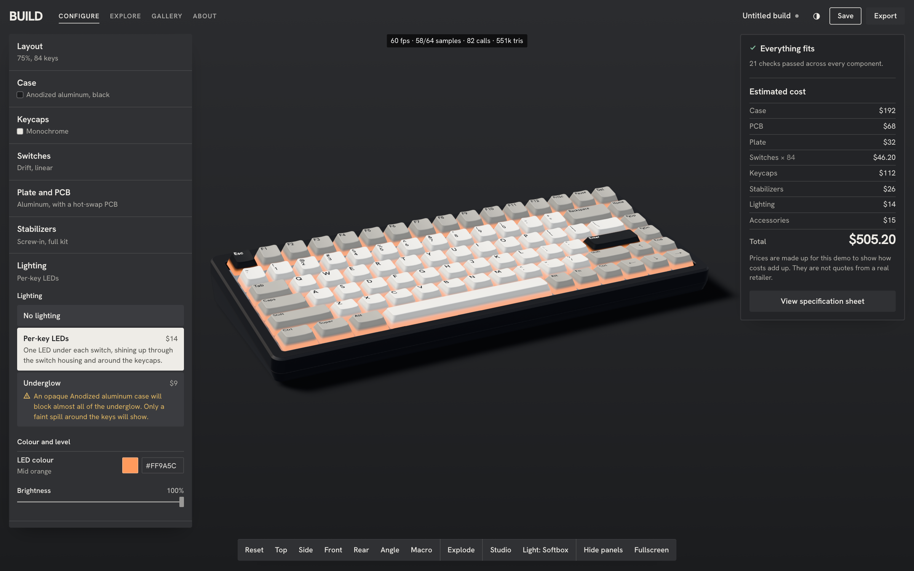 |
| 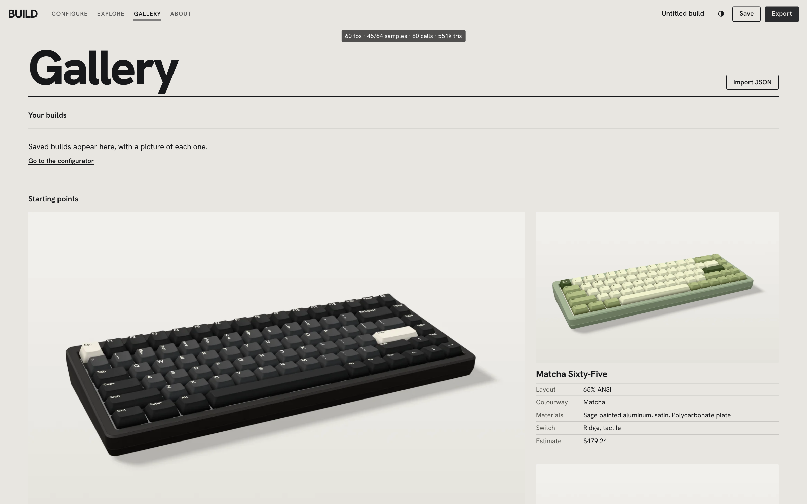 | 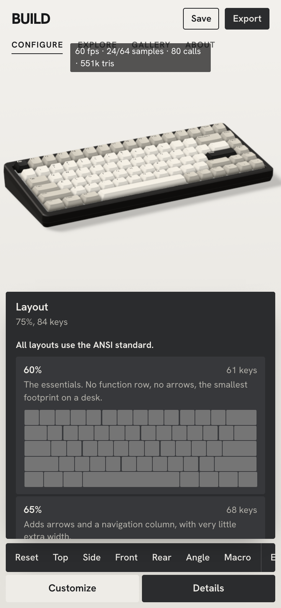 |

## How physical data becomes a keyboard

A layout definition is a list of rows of `[KeyboardEvent code, legend, width]`. `buildLayout()` turns it into positioned keys in millimetres, and that one result drives everything downstream:

```text
Layout data
   ├─ Plate    14 × 14 mm cutout per switch, stabilizer cutouts per long key
   ├─ PCB      hole per switch, traces routed between the real rows and columns
   ├─ Switches one instance per key
   ├─ Stabilizers at standard spacing for each long key, with a wire cut to length
   ├─ Keycaps  grouped by shape into instanced meshes
   └─ Case     outer size and key opening computed from the layout's own footprint
```

So the 65% and TKL aren't stretched versions of the 75%. They're separately computed parts, and the tests confirm that keys don't overlap, stems sit inside their keys, mounting holes miss the switches and a pressed cap clears the housing.

`src/model/assembly.js` holds the stack-up: housing height, plate thickness, the 6.5° wedge. The tilt comes from the geometry, and the case rests flat on the floor because the bottom plane is computed to do so.

### Procedural geometry

Everything is lofted from rounded-rectangle loops that keep the same vertex count at any size (`src/geometry/sweep.js`). three.js weights vertex normals by face area, so a short chamfer between two large flat faces picks up a smooth gradient while the flats stay flat. That's what makes small edges catch the light.

A keycap (`KeycapGeometry.js`) is a hollow shell with a stem socket, row tilt, a cylindrical or spherical dish, and a rounded top edge. Wide keys have a flat run with the dish rising at each end, as moulded keycaps do, and the spacebar is slightly convex.

The USB-C port needed a hole in the case without boolean geometry. A small mask writes the far depth into the depth buffer, so the port's interior shows through the wall.

### Rendering

**One draw call per key shape.** Keycaps sharing a shape share an `InstancedMesh`. Colour, legend position, roughness and metalness arrive as per-instance attributes on one shared material, so a theme change rewrites numbers and creates nothing. Picking uses an invisible box per key, not the full geometry.

**One texture of legends.** Legends are packed into a single-channel atlas once per layout. The shader projects them down onto the dished top from the key's local coordinates.

**Progressive refinement.** While anything moves, each frame is a single 4× MSAA image. When the view is still, `ProgressiveRenderer.jsx` jitters the camera by sub-pixel amounts, moves the key light across a disc and averages the results. That converges on area-light soft shadows and clean edges, then the render loop stops, and the GPU sits idle until something changes. Depth of field is the same loop with the camera moving across a lens, so it's real defocus and not a blur filter.

**Exports reuse the same loop.** A 4K export renders off-screen, one sample per task, so the page stays responsive and the export can be cancelled. Exports always show the actual scene.

**Colour that stays true.** Tone mapping is Khronos PBR Neutral, chosen because it keeps base colours accurate. Backdrops are passed through the inverse of that curve, so they appear in exactly the colour specified.

### Animation

Per-frame state lives in `configurator/runtime.js`, outside React. `KeyMotion.jsx` is the single system that moves keys, using springs for press and release. Each cap, its switch stem and its stabilizer stems are written from one number, so they can't drift apart.

The exploded view is one GSAP timeline driving one value from 0 to 1, and `layerOffsets()` maps that to a position per layer. Because it's a single value, play, pause, reverse and scrub are the same operation. GSAP also handles the opening and camera moves, which tween orbit angles so the camera arcs around the keyboard instead of cutting through it.

### The compatibility engine

`src/compatibility/rules.js` is a flat list of independent rules. Each one receives the resolved build and returns issues:

```js
{
  id: 'stabilizer-coverage',
  title: 'Enough stabilizers in the kit',
  check: ({ stab, layout }) => {
    const { small, large } = layout.stabilizerCounts;
    if (stab.kit.small >= small && stab.kit.large >= large) return [];
    return [{ ruleId: 'stabilizer-coverage', severity: 'error', message: '...', components: [...], suggestions: [...] }];
  },
}
```

- Nothing in the UI contains compatibility logic. To add a rule, append it to the list.
- Rules count things where they can. Keycap coverage compares how many caps of each size a set contains with what the layout needs, so a shortage is found by arithmetic.
- `evaluateOption()` runs the engine against a hypothetical change and reports only the issues it would add. That's what shows the warnings on options before you choose them.
- Suggestions are data, and they're applied by the same function as a normal choice. A test applies every suggestion from failing builds to prove that they resolve.

Well-formed data and compatible parts are separate questions. `validation.js` treats imported JSON as untrusted: it keeps only known ids, valid colours and known key ids, migrates older schema versions and rejects newer ones. An incompatible but well-formed build still loads, and the engine explains what's wrong.

### Sound

There are no recordings, so there's nothing to license or credit. `src/audio/synth.js` computes each sound from decaying sine modes and filtered noise bursts, parameterized by the switch, plate, case, foam and keycap material. Buffers are made on first use and cached, voices are capped at 24, and four seeded variations stop fast typing from sounding machine-gunned.

It's a stylised model, and it doesn't claim acoustic accuracy. The tests measure relationships such as "clicky is brighter than linear", but no test can judge whether it sounds good.

## Performance

Measured on one machine (Apple M4 Pro) in Chromium through Playwright, Metal backend, at 1440 × 900 with an 84-key board:

| | 1× pixel ratio | 2× pixel ratio |
|---|---|---|
| Frames drawn per second while orbiting | 59.4 | 59.1 |
| Frames drawn per second while typing | 60.1 | 60.3 |
| Frames drawn per second while exploding | 60.2 | 60.2 |
| Slowest 5% of frame gaps, orbiting | 16.7 ms | 16.7 ms |
| Full image, read back from the GPU (upper bound) | 4.9 ms | 5.98 ms |
| Frames drawn in 3 s of sitting idle | 0 | 0 |
| Applying a theme to every key | 0.1 ms | 0.1 ms |

The frame rates are capped by the test browser's 60 Hz refresh. The full-image figure shows the headroom: it includes the shadow pass and 4× MSAA, and it's a fast machine, so expect slower results on integrated graphics. The scene is 80 draw calls and 550k triangles.

Raw figures are in [docs/performance.json](docs/performance.json). Run `npm run measure` to measure your own machine.

Automatic quality starts from a guess based on the device and steps down if real frame times stay slow while the image is changing. It can also be set by hand in the Studio panel.

## Honest labels

- **Switches are invented.** Drift, Keel, Ridge, Knoll, Tick and Latch aren't products, and their figures are representative. The interface says so wherever figures appear.
- **Prices are illustrative.** They exist to show how a build's cost adds up, and they're labelled that way everywhere, including on the build sheet.
- **Compatibility rules are real constraints applied to a demo catalog.** Check real parts against their makers' documents.
- **The PCB art illustrates routing.** It follows the real rows and columns, but it isn't a working circuit design.

## Known limitations

- The browser can't see every key. Fn, some system shortcuts and combinations past the keyboard's rollover never arrive, and the tester says so.
- Soft shadows take about a second to refine, so they shift slightly between a moving and a still view.
- Reflections come from an environment map. Parts don't reflect each other, and ambient occlusion on keycaps is baked into the vertices.
- Frosted cases use three.js transmission, which is the most expensive material here.
- The USB-C port's recess is a depth trick. It isn't a real hole, and the case's wall thickness doesn't show at its edge.
- All layouts are ANSI. ISO isn't modelled.
- Sound has only been checked by measurement. It hasn't been tuned by ear.
- Tested in Chromium. Other browsers should work, as nothing here is Chromium-specific, but they aren't part of the automated run.

## Getting started

Requires Node 20.19+ or 22.12+.

```bash
npm install
```

```bash
npm run dev
```

## Commands

| Command | What it does |
|---|---|
| `npm run dev` | Development server |
| `npm run build` | Production build into `dist/` |
| `npm run preview` | Serve the production build |
| `npm test` | Unit tests |
| `npm run test:e2e` | Browser tests against a production build |
| `npm run screenshots` | Recapture `docs/screenshots` from the running app |
| `npm run measure` | Measure performance into `docs/performance.json` |
| `node scripts/capture-demo.mjs` | Rebuild `docs/demo.gif` |
| `node scripts/capture-starters.mjs` | Re-render the gallery's starter pictures |

Browser tests use Playwright with full Chromium:

```bash
npx playwright install chromium
```

Add `?debug` to the URL to show a live readout of frame rate, refinement samples, draw calls and triangles.

## Testing

| Suite | Tests | Covers |
|---|---|---|
| Unit (Vitest) | 200 | Layouts, key positions and sizes, geometry, stabilizers, the compatibility rules and invalid combinations, pricing, validation, migration, save and load, import and export, presets, per-key edits, state, reset, camera limits, material values, force curves, sound |
| Browser (Playwright) | 52 | Loading, layouts, case and keycap changes, per-key editing, switches, compatibility fixes, the exploded view, inspection, the tester, sound, saving and loading, the gallery, image and JSON export, the camera, dark mode, keyboard access, reduced motion, a phone viewport, low quality, WebGL failure |

To check that the visual tests can fail, the app was deliberately broken in four ways (case colour not applied, per-key edits ignored, keyboard hidden, stems not following keys), and each was caught.

Unit tests need no GPU, because all product logic is separate from rendering. Browser tests run the production build on a real GPU and look at outcomes as well as state: pixel colour after a change, the exact dimensions of a downloaded PNG, a build that survives save, reload and load unchanged, and a clear message when WebGL is unavailable.

## Deploying

The output is static files, so any static host works:

```bash
npm run build
```

Then publish `dist/`. On Vercel or Netlify, the build command is `npm run build` and the output directory is `dist`. Routing uses the URL hash, so no rewrite rules are needed.

## Stack

JavaScript (no TypeScript), React 19, Vite, Three.js, React Three Fiber, Drei, GSAP, Zustand, Tailwind CSS, Vitest and Playwright. The interface and keycap legends use Hanken Grotesk (SIL Open Font License).

```text
src/
  app/            App shell, routes, actions, automatic quality
  audio/          Sound synthesis and Web Audio playback
  catalog/        Component data: cases, switches, plates, PCBs, keycaps…
  compatibility/  The rules, the engine, and import validation
  components/     Interface
  configurator/   3D scene, renderer, camera, exploded view, key motion
  export/         PNG, build sheet, JSON
  geometry/       Procedural parts
  layouts/        Key data for each layout
  materials/      Surface values, shaders, studios
  model/          Build logic, pricing, force curves, assembly, inspector content
  pages/          Gallery, About
  state/          Zustand stores
  storage/        Saved builds
tests/
  unit/           No browser needed
  e2e/            Playwright
```
